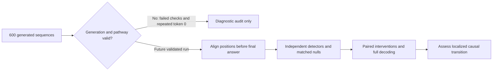
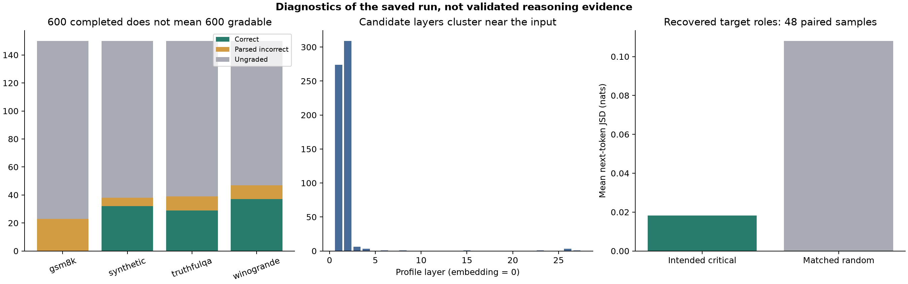
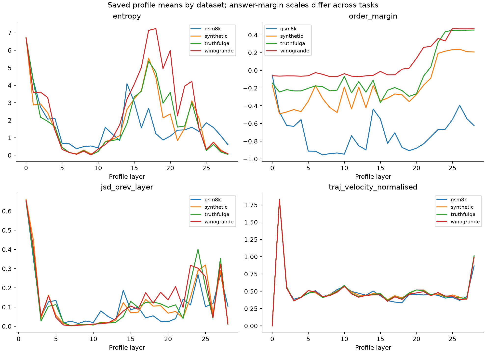

# NL2Ms raw-output audit, results, and research narrative

Audit date: 21 October 2026. All calculations are offline. Original evidence was preserved. No inference or paid API calls were run.

## 1. Decision

**The current outputs cannot establish or refute a genuine critical transition in successful transformer reasoning.** They establish that this measurement pipeline can return complete-looking transition summaries despite failed numerical/pathway checks and widespread degenerate generation. The strongest defensible narrative is an instrument-validity study: **candidate critical layers survive when meaningful answer production largely fails**. That is a useful diagnostic finding, but not yet a validated model of reasoning.

Suggested working title: **When Critical Layers Survive Failed Generation: Auditing Transition Detectors in Transformer Reasoning**. A positive critical-transition narrative would outrun the evidence. A general claim that transformers never undergo critical transitions would also outrun it.

## 2. Research question and what would answer it

The README asks whether a measurable localized transition occurs in hidden states, logits, attention, latent geometry or dynamics before the final answer, when a model “figures something out.” An adequate test needs coherent and correctly graded behavior, verified instrumentation, temporally aligned positions, nonredundant detector agreement beyond matched nulls, and matched perturbations that alter final answers. This run measures many layer-wise quantities, but those conditions are not met. A peak across network depth is also not by itself the time at which a multi-token solution is discovered.

## 3. Scope and accounting

The audit enumerates main, pilot and resume-test outputs separately, opens every unarchived NPZ array, reads every Parquet table and JSON result, checks historical archive members and preserves all four archive files. Git internals and Python/cache directories are excluded. Historical snapshots are not independent replications. The included source snapshot matches the current `nl2ms/*.py` files; this does not prove every historical snapshot used identical code.

| cohort | n_samples | n_generations | n_profile_samples | pathway_verified |
| --- | --- | --- | --- | --- |
| experiment | 600 | 600 | 600 | False |
| experiment_pilot | 16 | 16 | 16 | False |
| experiment_resume_test | 8 | 6 | 6 | False |

Main run: Qwen/Qwen2.5-7B-Instruct, 28 blocks, hidden width 3584, 4-bit weights, float16 computation, eager attention, greedy generation capped at 96 tokens. Saved resolved model commit: `a09a35458c702b33eeacc393d103063234e8bc28`. The configuration says revision `main`, but the resolved hash is available in model verification. One model and one main-run seed do not support cross-model or stochastic robustness conclusions.

## 4. Behavioral results with honest denominators

Conditional accuracy is correct / parsed-and-graded. End-to-end success is correct / questions with ground truth. Ungradable attempts count as failures to produce a scored answer for end-to-end success; their original correctness label remains null. The 21 deliberately undefined synthetic controls are excluded from ground-truth denominators. The saved report’s 0.744, 0.787 and 0.842 accuracies are conditional on successful parsing, not dataset-wide success.

| dataset | n | n_ground_truth | n_correct | n_incorrect | n_ungraded | parse_coverage | conditional_accuracy | end_to_end_success | all_token_zero | length_terminated |
| --- | --- | --- | --- | --- | --- | --- | --- | --- | --- | --- |
| all | 600 | 579 | 98 | 49 | 453 | 0.25389 | 0.66667 | 0.16926 | 439 | 476 |
| gsm8k | 150 | 150 | 0 | 23 | 127 | 0.15333 | 0 | 0 | 113 | 150 |
| synthetic | 150 | 129 | 32 | 6 | 112 | 0.29457 | 0.84211 | 0.24806 | 112 | 112 |
| truthfulqa | 150 | 150 | 29 | 10 | 111 | 0.26 | 0.74359 | 0.19333 | 111 | 111 |
| winogrande | 150 | 150 | 37 | 10 | 103 | 0.31333 | 0.78723 | 0.24667 | 103 | 103 |

Across 579 questions with ground truth, 98 were scored correct: **16.93% end-to-end success**, versus **66.67% conditional accuracy** on 147 graded outputs. The JSON contains Wilson 95% intervals for both rates. These are parser-based results, not human-validated correctness.

**439/600 outputs (73.17%) are entirely token ID 0 (`!`); 471/600 (78.5%) contain a majority of token 0; 476/600 (79.33%) hit the generation limit.** There are 453 ungraded outputs: 21 undefined controls and 432 unparsed outputs with ground truth. All 150 GSM8K outputs hit the cap; only 23 contain a parseable number and none is scored correct. This is not a representative estimate of the model’s arithmetic capability.

The numeric parser takes the last number anywhere in the output, so URL fragments or unfinished intermediate calculations can be graded as answers. Closed-set parsing searches for an option letter near the start; parser success should still be manually checked. There are no independent semantic annotations for refusal, faithfulness, hallucination or reasoning quality, so those rates cannot honestly be calculated.

## 5. Critical implementation and measurement findings

| Finding | Evidence | Consequence |
| --- | --- | --- |
| Pathway validation failed | Main, pilot and resume `config/model_verification.json`: `pathway_verified=false`, logit differences NaN; run log explicitly warns lens results are unreliable | Completion flags do not certify numerical validity. Diagnose before another experiment. |
| Severe token degeneration | Raw generated IDs, not just decoded text: 439 all-zero sequences | Most “transitions” describe invalid answer attempts. |
| Wrong geometry position | `pipeline.py:hidden_bank` uses index `min(1, n_positions-1)` instead of looking up the saved answer coordinate | If answer and last-input coincide, index 1 is usually the final generated position. |
| Missing critical labels | `interventions.py:run_interventions` inserts clipped negative offsets with `setdefault` before offset 0 | For 40/48 cases the target block has a pre-critical label. Raw report compares different sample populations. |
| Invalid GSM8K answer proxy | `_measure_output` renormalizes the singleton gold candidate and returns label `gold`; `_is_correct` compares it to the numeric truth | Margin is mechanically 1, answer label cannot change, and “correctness” is mechanically false. This does not measure answer robustness. |
| Regeneration agreement mislabeled | `analysis.py` computes fraction with `prediction_changed is not None` | 4/5 = 0.8 is availability of a flag, not agreement with next-token predictions. |
| Restricted sensitivity cohorts | Both phases select the first eligible samples; dataset order starts with GSM8K | All 64 J-space and 48 intervention samples are GSM8K; there are no correct examples in those cohorts. |
| Repeated perturbations treated as independent | Original intervention p-value shuffles rows | 6,525 rows are not 6,525 independent samples. Use paired sample-level inference. |
| Redundant detector inputs | Absolute and signed derivatives use the same margin profile | Eight detector names do not imply eight independent evidence sources. |
| Answer location is a token match | `extraction.py:plan_positions` uses first candidate-token occurrence, else prompt fallback | For numeric tasks this can be an intermediate digit, and fallback is not evidence that an answer formed. |

Geometry position mismatch was confirmed for **588/600 samples**: {'gsm8k': 139, 'truthfulqa': 150, 'winogrande': 150, 'synthetic': 149}. **Saved hidden-state finiteness is misleading here.** `extraction.py` applies `torch.nan_to_num` before writing tensors. Recomputed trajectories disagree in nonfinite masks for 36 main-run samples (432 metric checks), even though finite coordinates closely agree. For example, `gsm8k-da9e9737918f` has NaN in its original final-layer norm profile but an all-zero saved vector at that answer position. The saved tensors have lost the original nonfinite pattern. This is preprocessing loss, not repaired measurement validity. Pilot and resume checks show analogous mismatches for 1 and 2 samples respectively. Root cause of the generation/logit failure remains unproven: precision, quantized kernels, device placement and decoding need controlled tests. Batch-index counts do not show a simple one-good-row-per-batch pattern.

Geometry records list 600 bank IDs while reporting 256 used samples. Replaying the code’s fixed RNG subsample gives {'truthfulqa': 64, 'winogrande': 68, 'gsm8k': 63, 'synthetic': 61}. The 600 IDs are the bank, not all the geometry participants.

## 6. Transition shapes and detector trends

| shape | n | fraction |
| --- | --- | --- |
| distributed | 563 | 0.93833 |
| undetermined | 21 | 0.035 |
| sharp | 16 | 0.026667 |

All 600 receive a consensus, including all 439 all-zero generations. 583/600 (97.17%) consensus layers are at profile depths 1 or 2. Consensus here is a local cluster of at least three detectors within a tolerance, not unanimous agreement or a validated critical event. Broad disagreement can coexist with a consensus. The mean pairwise agreement reported by the run is about 0.344. No detector-independent estimate of “the model figured it out” exists.

| all_token_zero | dominant_transition_shape | n |
| --- | --- | --- |
| False | distributed | 157 |
| False | sharp | 4 |
| True | distributed | 406 |
| True | sharp | 12 |
| True | undetermined | 21 |

**12 of the 16 sharp cases (75%) are all-token-0 generations.** The stored dominant shape is a vote over detector classifications, not a direct estimate of a physical transition. The null sharpness fraction compares classifier behavior on generated AR(1) profiles; it does not control the observed degeneration, boundary effects or correlations among detectors. The raw AR(1) calibration is **4 sharp curves out of 12,000 (0.0333%)**, rounded to 0.0% in the saved report; it is not actually zero. Moreover, a single-curve sharpness rate and a majority/dominant classification over correlated detectors are different estimands. Recomputed detector outputs reproduce all saved consensus layers. Reproduction establishes implementation consistency, not scientific validity.

Boundary diagnostics in `supplement_results.json` repeat peak-location extraction after masking profile layers 0–2 and 0–4. These are sensitivity diagnostics, not alternative prespecified discovery thresholds. Do not select whichever masking gives an attractive story.

## 7. Correct-versus-incorrect associations

The original rank tests and mean-difference bootstrap intervals target different quantities. For consensus depth, a Mann–Whitney p≈0.737 and a mean-difference permutation p≈0.0015 can coexist under ties/outliers; this is not by itself an arithmetic bug. The report should identify the estimand rather than present them as interchangeable. The original JSON has 16 result entries but only 14 finite tests in the BH family, with duplicate JSD/curvature/velocity comparisons. It is misleading to describe eight significant entries as eight independent findings.

Below are independently recomputed within-dataset scalar tests. CI is the bootstrap interval for correct-minus-incorrect means; p is two-sided Mann–Whitney; q is BH within each dataset across the eight scalar metrics. No GSM8K comparison is estimable because there are no correct examples. These associations remain conditioned on parsing and the failed instrument.

| dataset | metric | n_correct | n_incorrect | mean_difference | hedges_g | ci_low | ci_high | p_value | q_bh | status |
| --- | --- | --- | --- | --- | --- | --- | --- | --- | --- | --- |
| gsm8k | critical_layer_consensus_normalised | 0 | 23 | NA | NA | NA | NA | NA | NA | insufficient_groups_minimum_5 |
| gsm8k | transition_strength | 0 | 23 | NA | NA | NA | NA | NA | NA | insufficient_groups_minimum_5 |
| gsm8k | detector_spread | 0 | 23 | NA | NA | NA | NA | NA | NA | insufficient_groups_minimum_5 |
| gsm8k | max_jsd | 0 | 23 | NA | NA | NA | NA | NA | NA | insufficient_groups_minimum_5 |
| gsm8k | max_curvature | 0 | 23 | NA | NA | NA | NA | NA | NA | insufficient_groups_minimum_5 |
| gsm8k | max_velocity | 0 | 23 | NA | NA | NA | NA | NA | NA | insufficient_groups_minimum_5 |
| gsm8k | final_entropy | 0 | 21 | NA | NA | NA | NA | NA | NA | insufficient_groups_minimum_5 |
| gsm8k | max_margin | 0 | 23 | NA | NA | NA | NA | NA | NA | insufficient_groups_minimum_5 |
| synthetic | critical_layer_consensus_normalised | 32 | 6 | 0.0093006 | 0.50844 | -0.0055804 | 0.023438 | 0.25493 | 0.4079 | ok |
| synthetic | transition_strength | 32 | 6 | 0.018477 | 0.8558 | -0.00053212 | 0.038057 | 0.08157 | 0.16314 | ok |
| synthetic | detector_spread | 32 | 6 | 0.43482 | 0.25348 | -1.0243 | 2.1107 | 0.58643 | 0.58643 | ok |
| synthetic | max_jsd | 32 | 6 | -0.0025783 | -0.16406 | -0.0091079 | 0.0011101 | 0.39905 | 0.53206 | ok |
| synthetic | max_curvature | 32 | 6 | -0.002476 | -0.2056 | -0.0077459 | 0.00051212 | 0.51855 | 0.58643 | ok |
| synthetic | max_velocity | 32 | 6 | -0.002098 | -0.59277 | -0.0035423 | -0.0011976 | 0.0045525 | 0.01214 | ok |
| synthetic | final_entropy | 32 | 6 | -0.21415 | -1.4771 | -0.45572 | 0.008906 | 0.00045931 | 0.0018372 | ok |
| synthetic | max_margin | 32 | 6 | 0.5842 | 3.545 | 0.27918 | 0.88973 | 6.1482e-05 | 0.00049185 | ok |
| truthfulqa | critical_layer_consensus_normalised | 29 | 10 | -0.0045567 | -0.30439 | -0.016502 | 0.0061576 | 0.40795 | 0.54394 | ok |
| truthfulqa | transition_strength | 29 | 10 | 0.0099958 | 0.51866 | -0.0047931 | 0.024287 | 0.24041 | 0.48082 | ok |
| truthfulqa | detector_spread | 29 | 10 | 1.2011 | 0.76673 | -0.058596 | 2.4736 | 0.077502 | 0.20667 | ok |
| truthfulqa | max_jsd | 29 | 10 | 0.00023327 | 0.081332 | -0.0017539 | 0.0022078 | 0.78455 | 0.80938 | ok |
| truthfulqa | max_curvature | 29 | 10 | -0.00075457 | -0.21625 | -0.0031476 | 0.0014738 | 0.80938 | 0.80938 | ok |
| truthfulqa | max_velocity | 29 | 10 | 0.00040598 | 0.38406 | -0.00032224 | 0.001152 | 0.37643 | 0.54394 | ok |
| truthfulqa | final_entropy | 29 | 10 | -0.011451 | -1.4155 | -0.021644 | -0.0033182 | 0.00054508 | 0.0021803 | ok |
| truthfulqa | max_margin | 29 | 10 | 0.68038 | 3.4817 | 0.46339 | 0.91394 | 9.8778e-07 | 7.9022e-06 | ok |
| winogrande | critical_layer_consensus_normalised | 37 | 10 | -0.0035714 | -0.69526 | -0.010714 | 2.7756e-17 | 0.061269 | 0.15866 | ok |
| winogrande | transition_strength | 37 | 10 | 0.018666 | 1.1072 | 0.0091076 | 0.028465 | 0.0040748 | 0.016299 | ok |
| winogrande | detector_spread | 37 | 10 | 0.51232 | 0.48554 | -0.44926 | 1.3852 | 0.41244 | 0.54253 | ok |
| winogrande | max_jsd | 37 | 10 | -0.00024704 | -0.10711 | -0.0018437 | 0.0013869 | 0.61224 | 0.61224 | ok |
| winogrande | max_curvature | 37 | 10 | 0.0018945 | 0.70322 | 0.00029838 | 0.0036068 | 0.079331 | 0.15866 | ok |
| winogrande | max_velocity | 37 | 10 | -0.00014702 | -0.27643 | -0.00046909 | 0.00018387 | 0.47472 | 0.54253 | ok |
| winogrande | final_entropy | 37 | 10 | -0.13467 | -0.60533 | -0.33899 | 0.047301 | 0.12195 | 0.19512 | ok |
| winogrande | max_margin | 37 | 10 | 0.55552 | 2.7913 | 0.30052 | 0.79703 | 6.0174e-06 | 4.8139e-05 | ok |

The CSV/JSON also contain per-dataset peak comparisons for every saved profile, with BH across finite profile tests in each dataset. These are an exploratory screen. Margin-related effects are partly linked to the definition of a correct answer, not independent discovery of a reasoning mechanism. Entropy, curvature and attention associations cannot rescue the validity failures or support causation. Closed-set and open-vocabulary margins are on different scales; pooled margin comparisons are retained only as historical diagnostics.

## 8. Causal perturbations: original, paired, and repaired accounting

The original aggregate reports critical JSD≈0.0860 versus random≈0.1080. Only 8 samples actually have the critical role label; 48 contribute controls. We report both a paired comparison using existing labels and a bookkeeping repair using `layer == critical_layer`. Each sample is averaged over kind/epsilon and its random controls before inference.

| version | n_pairs | critical_mean | random_mean | mean_difference | ci_low | ci_high | p_value |
| --- | --- | --- | --- | --- | --- | --- | --- |
| paired_original_roles | 8 | 0.086048 | 0.13156 | -0.045512 | -0.098474 | 0.014771 | 0.15848 |
| paired_recovered_target_roles | 48 | 0.018211 | 0.10803 | -0.089821 | -0.11311 | -0.067978 | 9.999e-05 |

The recovered 48-sample contrast is **-0.08982 nats**, bootstrap 95% CI [-0.11311, -0.06798]; sign-flip Monte Carlo p=9.999e-05 (10,000 flips, plus-one correction). Intended critical blocks are less sensitive on this stored next-token JSD measure. This rejects neither the general phase-transition hypothesis nor the possibility of a later reasoning event: almost all targets are early, all samples are failed/incorrect GSM8K generations, and the answer proxy is broken. A non-significant original p-value should not have been presented as proof of no causal privilege.

The per-kind/per-epsilon contrasts below are exploratory. The repaired p-values are unadjusted; they are not a family of confirmatory discoveries. Epsilons 0.5, 1 and 2 perturb by 50%, 100% and 200% of residual norm, so this is not purely a small-perturbation regime. Random controls are sampled outside selected target/neighbour/absolute layers, not depth-matched controls.

| kind | epsilon | n_pairs | difference | ci_low | ci_high | p_signflip |
| --- | --- | --- | --- | --- | --- | --- |
| along_answer_dir | 0.5 | 48 | -0.043902 | -0.081459 | -0.0064699 | 0.025797 |
| along_answer_dir | 1 | 48 | -0.065973 | -0.11188 | -0.014761 | 0.012699 |
| along_answer_dir | 2 | 48 | -0.14949 | -0.20834 | -0.093772 | 9.999e-05 |
| cross_sample | 0.5 | 48 | -0.053789 | -0.087797 | -0.022905 | 0.0023998 |
| cross_sample | 1 | 48 | -0.083212 | -0.12622 | -0.040192 | 0.00029997 |
| cross_sample | 2 | 48 | -0.18856 | -0.23847 | -0.13854 | 9.999e-05 |
| gaussian | 0.5 | 48 | -0.01869 | -0.033023 | -0.0088668 | 9.999e-05 |
| gaussian | 1 | 48 | -0.063567 | -0.089206 | -0.041996 | 9.999e-05 |
| gaussian | 2 | 48 | -0.18772 | -0.24549 | -0.1266 | 9.999e-05 |
| orthogonal_to_answer_dir | 0.5 | 48 | -0.018719 | -0.033031 | -0.0091762 | 9.999e-05 |
| orthogonal_to_answer_dir | 1 | 48 | -0.062732 | -0.086388 | -0.041689 | 9.999e-05 |
| orthogonal_to_answer_dir | 2 | 48 | -0.18978 | -0.24583 | -0.13001 | 9.999e-05 |
| pca_direction | 0.5 | 48 | -0.012648 | -0.02437 | -0.0036507 | 0.010099 |
| pca_direction | 1 | 48 | -0.054964 | -0.096032 | -0.022988 | 0.00019998 |
| pca_direction | 2 | 48 | -0.15357 | -0.23864 | -0.067069 | 0.00069993 |

The saved `gold` labels, singleton margins and all-false answer changes must not be interpreted as invariant numeric answers. Full-decoding checks have only five records, lack a genuine matched proxy-agreement computation, and use independently constructed perturbation seeds/contexts. Retain them as raw observations, not behavioral validation.

## 9. Geometry, attention, J-space and temporal scope

All 25 stored population-geometry profiles were recomputed from the saved bank using the original position-selection and subsampling logic, and all matched within 1e-5 tolerances. This confirms reproduction of the flawed position convention. Effective rank is calculated from a truncated spectrum (up to 64 components), so it is not the full representation rank. Local covariance uses at most 10 available nearest neighbours despite the configured 16, and centering makes its smallest singular value near zero; a very large local anisotropy ratio can be structural.

| metric | first_layer | first | last | peak_layer | peak |
| --- | --- | --- | --- | --- | --- |
| norm_mean | 0 | 0.979 | 320.42 | 27 | 327.57 |
| effective_rank | 0 | 15.605 | 42.959 | 27 | 43.983 |
| participation_ratio | 0 | 3.1581 | 3.2145 | 28 | 3.2145 |
| pc1_explained_variance | 0 | 0.54205 | 0.51422 | 8 | 0.71741 |
| n_components_90pct | 0 | 9 | 29 | 27 | 32 |
| mean_cosine_similarity | 0 | 0.6296 | 0.54626 | 27 | 0.74586 |
| anisotropy | 0 | 0.6296 | 0.54626 | 27 | 0.74586 |
| mean_pairwise_distance | 0 | 0.52806 | 297.02 | 28 | 297.02 |
| distance_cv | 0 | 1.2347 | 0.43466 | 0 | 1.2347 |
| covariance_trace | 0 | 0.35196 | 52443 | 28 | 52443 |
| twonn_intrinsic_dimension | 0 | 77.483 | 8.5427 | 0 | 77.483 |
| within_class_distance_mean | 0 | 1.1624 | 253.56 | 28 | 253.56 |
| between_class_distance_mean | 0 | 1.2011 | 342.26 | 28 | 342.26 |
| separation_ratio | 0 | 1.0334 | 1.3498 | 28 | 1.3498 |
| fisher_ratio | 0 | 0.90941 | 1.1765 | 4 | 1.2715 |
| class_mean_distance | 0 | 0.26847 | 177.98 | 28 | 177.98 |
| knn_distance_mean | 0 | 0.13271 | 128.25 | 28 | 128.25 |
| knn_distance_ratio_mean | 0 | 1.4317e+11 | 8.5425e+12 | 28 | 8.5425e+12 |
| local_density_log_mean | 0 | 25.048 | -2.6461 | 0 | 25.048 |
| local_anisotropy_mean | 0 | 2.8339e+11 | 1.607e+14 | 28 | 1.607e+14 |
| local_effective_rank_mean | 0 | 0.33302 | 7.95 | 26 | 8.1917 |
| neighbourhood_purity | 0 | 0.63393 | 0.73968 | 28 | 0.73968 |
| knn_jaccard | 1 | 0.13319 | 0.69758 | 16 | 0.85688 |
| neighbourhood_reorganisation | 1 | 0.86681 | 0.30242 | 1 | 0.86681 |
| effective_rank_delta | 0 | 12.779 | -1.0235 | 0 | 12.779 |

Attention profiles aggregate heads and selected positions; they are not necessarily at exactly the same token as the answer-position logit/trajectory profiles. Head-and-position summaries, all saved profiles, and per-position lens values are in the CSV. Full attention is stored for four main-run samples only.

J-space contains 64 GSM8K samples, eight directions and three epsilons (0.001, 0.01, 0.1). Nine have parsed incorrect answers and none are correct, so correct/incorrect separability is unavailable. `extended_results.json` recomputes finite-direction means, peaks and cross-epsilon rank correlations from the saved descriptors. Re-running the underlying finite-difference probes requires the model.

Per-position lens summaries cover a capped generated prefix (up to 48 positions), plus selected answer/final positions. Raw hidden tensors retain only selected positions, not the full generation trajectory. Full-vocabulary logits are not saved. Consequently, full-vocabulary entropy/KL/JSD cannot be independently reconstructed from top-20 probabilities alone; the audit preserves those stored measures and checks their derived summaries instead. There are no saved data sufficient for new tuned-lens training, arbitrary causal interventions, or full post-prefix hidden-state timing analyses.

## 10. Historical runs and provenance

| archive | member | n | correct | incorrect | all_zero |
| --- | --- | --- | --- | --- | --- |
| experiment_backup_20261014_172855.tar.gz | experiment_pilot/raw/generations/generations.jsonl | 16 | 3 | 1 | 12 |
| experiment_backup_20261014_175711.tar.gz | experiment_pilot/raw/generations/generations.jsonl | 16 | 3 | 1 | 12 |
| experiment_backup_20261018_214237.tar.gz | experiment_pilot/raw/generations/generations.jsonl | 16 | 3 | 1 | 12 |
| experiment_backup_20261019_013140.tar.gz | experiment/raw/generations/generations.jsonl | 600 | 98 | 49 | 439 |

Every member was read and hashed. Archives are included byte-for-byte in the all-in-one JSON and indexed in audit results. These snapshots may overlap current sample IDs and each other; never sum them as additional subjects. Pilot/resume observations are engineering checks, not independent validation cohorts. Neither their completion nor the resume test fixes failed model-pathway verification.

## 11. Strongest narrative and claim boundaries

**Supported now:** “In this saved Qwen run, the pipeline assigned a candidate consensus layer to every sample, including 439 sequences containing only token ID 0. Nearly all consensus locations lay within the first two post-embedding depths. An audit found failed logit-pathway verification, position-selection errors in geometry, and invalid open-vocabulary intervention scoring. These observations show why completed extraction and detector agreement alone are insufficient evidence for a reasoning transition.”

**Exploratory after clear caveats:** the run is dominated by distributed profile classifications; intended early critical blocks have lower next-token distribution sensitivity than random controls under recovered pairing; some parsed-correct and parsed-incorrect cases have different profile statistics. These are properties of this saved run and its measurement conventions.

**Not supported:** a universal critical layer; a thermodynamic phase transition; a causal moment of insight; superiority or robustness across models; a general absence of reasoning transitions; 74–84% dataset-wide accuracy; 80% proxy validation; invariant numeric answers under perturbation. No critical exponents, finite-size scaling or order-parameter singularity were tested.

A plausible revised paper can focus on **validating proposed transition indicators against failed-generation and boundary controls**. It needs a clean reference run to show which effects survive repair. Until then, treat this as a rigorous diagnostic report and a hypothesis-generating instrument audit, not a completed mechanism paper.

## 12. What remains to run, in priority order

| Priority | can return complete-looking transition summaries despite failed numerical/pathway checks and widespread degenerate generation. The strongest defensible narrative is an instrument-validity study: **candidate critical layers survive when meaningful answer production largely fails**. That is a useful diagnostic finding, but not yet a validated model of reasoning.Work | Concrete design / gate | Why |
| --- | --- | --- | --- |
| P0 offline | Fix and test measurement code | Explicit finite checks; fail on pathway mismatch; coordinate-based hidden-bank selection; target-role precedence; separate open-vocab scoring; actual matched proxy confusion matrix | Prevent another invalid full run |
| P0 offline | Validate parsing | Manually review all 147 currently graded outputs, including 23 GSM8K numeric parses; define final-answer parsing rules before rerun | Current labels may include incidental numbers/letters |
| P1 small GPU diagnostic | Diagnose numerical failure | 16 fixed balanced prompts, plain generation and instrumented forward; batch 1 vs 4; single-device vs current sharding where feasible; compare validated precision/quantization paths one factor at a time | Root cause is unknown; token-0 collapse is not an acceptable baseline |
| P1 gate | Require a clean pilot | All logits/probabilities finite; final-norm/head logits reproduce reference within declared tolerance; readable answers; parsed labels reviewed; hooks leave baseline unchanged | Stop immediately on failure, before J-space/interventions |
| P2 clean main | Rerun the 600-item mixture after fixes | Preserve this cohort separately; log model hash, dependency versions, hardware, per-call timing; grade all truth-bearing attempts with explicit parse-failure reporting | This dataset has no valid replacement yet |
| P2 temporal controls | Align the proposed event | Prompt-last, true final-answer predecessor, earlier generated tokens and final token; record exact token IDs/coordinates; extend cap only after inspecting truncation | Distinguish layer-depth transitions from answer emission or long generation |
| P2 causal pilot | Stratify eligible samples | Start with 64 valid items, 16 per dataset where feasible, balancing correct/incorrect after grading; then size a confirmatory cohort using independent sample-level variance | Existing causal/J-space cohorts contain only GSM8K failures |
| P2 causal validation | Matched interventions | Critical, nearby, random and depth-matched controls; same directions/seeds/norm ratios; include small epsilons; actual final-answer decoding; paired sample analysis | Measures behavioral effects rather than a singleton-candidate artifact |
| P3 null calibration | Validate specificity | Healthy outputs, failed outputs, matched nonreasoning tasks, correct/incorrect labels permuted within task/length strata, boundary-masked analyses, norm/no-norm or calibrated readout controls | Tests whether peaks track reasoning rather than architecture/readout/degeneration |
| P3 replication | Second model and seed variation | One second architecture after a stable primary experiment; separately report seeds and quantization/precision variants | Needed for any broader claim |
| P3 confirmatory test | Freeze primary estimand | Define localization, independent detector agreement, and paired full-answer perturbation effect in advance; estimate sample count from a separate clean pilot | Avoid selecting a narrative from many metrics |

These are proposed new experiments, not claimed results. No new GPU runs were launched. Do not spend compute scaling the current configuration before P0/P1 pass. The present measurements are too compromised for a credible power calculation for the intended reasoning effect. A diagnostic batch size is not a statistically justified final sample size.

## 13. Reproducibility and artifact guide

- `all_results_and_raw_outputs.json`: one strict JSON document with readable raw generations/questions, computed results, an indexed lossless copy of every scientific source artifact, and all historical archives. Binary NPZ/Parquet/PDF/image/archive files are stored in base64 chunks with SHA-256 hashes; concatenate decoded chunks by hash and index to restore. Original JSON NaN/Infinity bytes are preserved; parsed views use null.
- `combined_results.csv`: long-form combined export. Use `record_type`, `source`, `sample_id`, `layer`, `position`, `metric` and `statistic` to select rows. It includes all saved table columns and JSON leaves, sample-layer profiles, per-position lens scalars, attention summaries, raw generation records, array inventories and new statistics. Dense hidden/attention tensor coordinates remain losslessly embedded in the JSON; CSV reports their summaries rather than billions of coordinates.
- `audit_results.json`, `supplement_results.json`, `extended_results.json`: smaller machine-readable analysis views.
- `audit_outputs.py`, `audit_supplement.py`, `finish_analysis.py`, `finalize_details.py`, `package_evidence.py`, `verify_bundle.py`: executable provenance. Run once in that order with Python, NumPy, pandas, SciPy, PyArrow and Matplotlib. Run the supplement with BLAS thread limits for predictable resource use. `finish_analysis.py` appends supplemental rows, so regenerate the CSV with `audit_outputs.py` before repeating the whole sequence.
- `verification.json`: final byte-integrity and CSV/JSON validation results. A serialization PASS does not imply scientific validity.

All available metric families are inventoried; not every desired scientific metric is identifiable from saved data. Original null tests, confound models and no-norm summaries are preserved as original analyses, not claimed as independently re-executed tests. No new literature or novelty search was performed; this report makes claims about the local evidence, not priority over prior research.

## 14. Complete profile trend catalogue

For each dataset and every stored profile: first/last finite layer means, maximum population-mean location, and final finite sample count. Means exclude nonfinite entries, which are inventoried separately. Peak of the population mean is not mean of individual peak locations. Layer 0 is the embedding. These are diagnostic descriptions, not validated effects.

Interpretation key: entropy/concentration describe prediction uncertainty; order/candidate/rank variables describe candidate preference (task-dependent scale); JSD/KL describe readout movement; trajectory variables describe representation movement/scale; attention variables describe allocation and head/position aggregation. Increasing concentration need not mean increasing correctness, and motion need not mean reasoning.

| dataset | metric | first_finite_layer | first_mean | last_finite_layer | last_mean | peak_layer | peak_mean | last_n_finite |
| --- | --- | --- | --- | --- | --- | --- | --- | --- |
| gsm8k | attn_attention_to_generated_head_std | 1 | 0.28896 | 28 | 0.33538 | 28 | 0.33538 | 150 |
| gsm8k | attn_attention_to_generated_max | 1 | 1 | 28 | 1 | 20 | 1 | 150 |
| gsm8k | attn_attention_to_generated_mean | 1 | 0.55349 | 28 | 0.29988 | 1 | 0.55349 | 150 |
| gsm8k | attn_attention_to_prompt_head_std | 1 | 0.28896 | 28 | 0.33538 | 28 | 0.33538 | 150 |
| gsm8k | attn_attention_to_prompt_max | 1 | 1 | 28 | 1 | 5 | 1 | 150 |
| gsm8k | attn_attention_to_prompt_mean | 1 | 0.44651 | 28 | 0.70012 | 15 | 0.82485 | 150 |
| gsm8k | attn_attention_to_self_head_std | 1 | 0.24241 | 28 | 0.32896 | 28 | 0.32896 | 150 |
| gsm8k | attn_attention_to_self_max | 1 | 1 | 28 | 1 | 1 | 1 | 150 |
| gsm8k | attn_attention_to_self_mean | 1 | 0.1232 | 28 | 0.14742 | 28 | 0.14742 | 150 |
| gsm8k | attn_concentration_gini_head_std | 1 | 0.13722 | 28 | 0.066878 | 2 | 0.17783 | 150 |
| gsm8k | attn_concentration_gini_max | 1 | 0.99481 | 28 | 0.99481 | 1 | 0.99481 | 150 |
| gsm8k | attn_concentration_gini_mean | 1 | 0.76712 | 28 | 0.8509 | 11 | 0.93566 | 150 |
| gsm8k | attn_distance_std_head_std | 1 | 9.8953 | 28 | 14.785 | 28 | 14.785 | 150 |
| gsm8k | attn_distance_std_max | 1 | 62.312 | 28 | 62.385 | 11 | 93.619 | 150 |
| gsm8k | attn_distance_std_mean | 1 | 25.833 | 28 | 33.004 | 14 | 44.316 | 150 |
| gsm8k | attn_effective_support_head_std | 1 | 22.328 | 28 | 8.9988 | 2 | 28.452 | 150 |
| gsm8k | attn_effective_support_max | 1 | 143.86 | 28 | 82.473 | 2 | 153.74 | 150 |
| gsm8k | attn_effective_support_mean | 1 | 35.544 | 28 | 16.154 | 2 | 42.418 | 150 |
| gsm8k | attn_entropy_head_std | 1 | 1.1164 | 28 | 0.97895 | 1 | 1.1164 | 150 |
| gsm8k | attn_entropy_max | 1 | 4.965 | 28 | 4.399 | 2 | 5.0294 | 150 |
| gsm8k | attn_entropy_mean | 1 | 3.1517 | 28 | 2.4053 | 3 | 3.5293 | 150 |
| gsm8k | attn_entropy_normalised_head_std | 1 | 0.23261 | 28 | 0.20402 | 1 | 0.23261 | 150 |
| gsm8k | attn_entropy_normalised_max | 1 | 0.94977 | 28 | 0.84385 | 2 | 0.96411 | 150 |
| gsm8k | attn_entropy_normalised_mean | 1 | 0.6567 | 28 | 0.5019 | 3 | 0.73556 | 150 |
| gsm8k | attn_max_attention_head_std | 1 | 0.25316 | 28 | 0.23215 | 1 | 0.25316 | 150 |
| gsm8k | attn_max_attention_max | 1 | 1 | 28 | 1 | 1 | 1 | 150 |
| gsm8k | attn_max_attention_mean | 1 | 0.22871 | 28 | 0.47222 | 5 | 0.66498 | 150 |
| gsm8k | attn_mean_distance_head_std | 1 | 19.264 | 28 | 32.803 | 28 | 32.803 | 150 |
| gsm8k | attn_mean_distance_max | 1 | 139.85 | 28 | 168.56 | 15 | 192.09 | 150 |
| gsm8k | attn_mean_distance_mean | 1 | 29.409 | 28 | 62.05 | 15 | 88.303 | 150 |
| gsm8k | attn_restructuring_cosine_similarity | 1 | 1 | 28 | 0.52136 | 1 | 1 | 92 |
| gsm8k | attn_restructuring_frobenius_delta | 1 | 0 | 28 | 23.719 | 5 | 29.76 | 92 |
| gsm8k | attn_restructuring_jsd_delta | 1 | 0 | 28 | 0.30624 | 5 | 0.50826 | 92 |
| gsm8k | attn_sparsity_frac_below_head_std | 1 | 0.099988 | 28 | 0.073088 | 1 | 0.099988 | 150 |
| gsm8k | attn_sparsity_frac_below_max | 1 | 0.99481 | 28 | 0.99481 | 1 | 0.99481 | 150 |
| gsm8k | attn_sparsity_frac_below_mean | 1 | 0.79429 | 28 | 0.86755 | 11 | 0.92516 | 150 |
| gsm8k | attn_top1_minus_top2_head_std | 1 | 0.26194 | 28 | 0.26251 | 5 | 0.27951 | 150 |
| gsm8k | attn_top1_minus_top2_max | 1 | 1 | 28 | 1 | 1 | 1 | 150 |
| gsm8k | attn_top1_minus_top2_mean | 1 | 0.13674 | 28 | 0.38689 | 5 | 0.60325 | 150 |
| gsm8k | entropy | 0 | 6.6924 | 28 | 0.60029 | 0 | 6.6924 | 126 |
| gsm8k | entropy_curvature | 0 | 0.4401 | 28 | -0.019541 | 2 | 0.82097 | 126 |
| gsm8k | entropy_delta | 0 | -2.407 | 28 | -0.50943 | 13 | 1.4445 | 126 |
| gsm8k | entropy_normalised | 0 | 0.56088 | 28 | 0.050309 | 0 | 0.56088 | 126 |
| gsm8k | jsd_final_layer | 0 | 0.69281 | 28 | 0 | 10 | 0.6929 | 126 |
| gsm8k | jsd_first_layer | 1 | 0.64901 | 28 | 0.69293 | 28 | 0.69293 | 126 |
| gsm8k | jsd_prev_layer | 1 | 0.64901 | 28 | 0.10458 | 1 | 0.64901 | 126 |
| gsm8k | kl_prev_layer | 1 | 9.2544 | 28 | 1.8732 | 1 | 9.2544 | 126 |
| gsm8k | logit_max | 0 | 12.86 | 28 | 32.962 | 28 | 32.962 | 126 |
| gsm8k | logit_mean | 0 | -0.53883 | 28 | 1.5832 | 28 | 1.5832 | 126 |
| gsm8k | logit_std | 0 | 2.7271 | 28 | 2.4588 | 0 | 2.7271 | 126 |
| gsm8k | order_best_wrong_prob | 0 | 0.053276 | 28 | 0.69494 | 7 | 0.95519 | 126 |
| gsm8k | order_confidence | 0 | 0.053276 | 28 | 0.76276 | 7 | 0.95519 | 126 |
| gsm8k | order_correct_prob | 0 | 2.8848e-05 | 28 | 0.070958 | 28 | 0.070958 | 126 |
| gsm8k | order_log_odds | 0 | -13.276 | 28 | -19.231 | 1 | -9.7789 | 126 |
| gsm8k | order_margin | 0 | -0.053248 | 28 | -0.62399 | 0 | -0.053248 | 126 |
| gsm8k | order_margin_curvature | 0 | 0.13164 | 28 | 0.029473 | 1 | 0.1674 | 126 |
| gsm8k | order_margin_delta | 0 | -0.4163 | 28 | -0.094023 | 13 | 0.20751 | 126 |
| gsm8k | order_rank | 0 | 18716 | 28 | 1403 | 11 | 1.2148e+05 | 150 |
| gsm8k | top1_minus_top2 | 0 | 0.01239 | 28 | 0.59136 | 7 | 0.9461 | 126 |
| gsm8k | top1_prob | 0 | 0.053276 | 28 | 0.76276 | 7 | 0.95519 | 126 |
| gsm8k | topk_mass | 0 | 0.34963 | 28 | 0.99953 | 28 | 0.99953 | 126 |
| gsm8k | traj_acceleration | 0 | 10.311 | 28 | 165.09 | 28 | 165.09 | 126 |
| gsm8k | traj_cosine_displacement | 0 | 0 | 28 | 0.63777 | 26 | 0.95183 | 126 |
| gsm8k | traj_cosine_to_final | 0 | -0.026489 | 28 | 1 | 28 | 1 | 126 |
| gsm8k | traj_cosine_to_first | 0 | 1 | 28 | -0.026489 | 0 | 1 | 126 |
| gsm8k | traj_curvature | 0 | 0 | 28 | 0 | 3 | 0.22428 | 150 |
| gsm8k | traj_displacement_from_first | 0 | 0 | 28 | 333.04 | 27 | 382.09 | 126 |
| gsm8k | traj_displacement_from_last | 0 | 333.04 | 28 | 0 | 0 | 333.04 | 126 |
| gsm8k | traj_norm | 0 | 0.92222 | 28 | 333.01 | 27 | 382.09 | 126 |
| gsm8k | traj_path_length | 0 | 0 | 28 | 1255.9 | 28 | 1255.9 | 126 |
| gsm8k | traj_turning_angle | 0 | 0 | 28 | 0 | 27 | 1.9111 | 150 |
| gsm8k | traj_velocity | 0 | 0 | 28 | 309.6 | 28 | 309.6 | 126 |
| gsm8k | traj_velocity_normalised | 0 | 0 | 28 | 0.8663 | 1 | 1.8264 | 126 |
| synthetic | attn_attention_to_generated_head_std | 1 | 0.25903 | 28 | 0.30074 | 28 | 0.30074 | 150 |
| synthetic | attn_attention_to_generated_max | 1 | 1 | 28 | 1 | 28 | 1 | 150 |
| synthetic | attn_attention_to_generated_mean | 1 | 0.42211 | 28 | 0.25611 | 1 | 0.42211 | 150 |
| synthetic | attn_attention_to_prompt_head_std | 1 | 0.25903 | 28 | 0.30074 | 28 | 0.30074 | 150 |
| synthetic | attn_attention_to_prompt_max | 1 | 1 | 28 | 1 | 5 | 1 | 150 |
| synthetic | attn_attention_to_prompt_mean | 1 | 0.57789 | 28 | 0.74389 | 15 | 0.87168 | 150 |
| synthetic | attn_attention_to_self_head_std | 1 | 0.23602 | 28 | 0.31706 | 28 | 0.31706 | 150 |
| synthetic | attn_attention_to_self_max | 1 | 1 | 28 | 1 | 28 | 1 | 150 |
| synthetic | attn_attention_to_self_mean | 1 | 0.12439 | 28 | 0.17052 | 28 | 0.17052 | 150 |
| synthetic | attn_concentration_gini_head_std | 1 | 0.14024 | 28 | 0.079734 | 2 | 0.18458 | 150 |
| synthetic | attn_concentration_gini_max | 1 | 0.99308 | 28 | 0.99308 | 28 | 0.99308 | 150 |
| synthetic | attn_concentration_gini_mean | 1 | 0.74227 | 28 | 0.8148 | 11 | 0.91996 | 150 |
| synthetic | attn_distance_std_head_std | 1 | 7.7601 | 28 | 10.593 | 5 | 11.634 | 150 |
| synthetic | attn_distance_std_max | 1 | 52.146 | 28 | 45.768 | 12 | 74.492 | 150 |
| synthetic | attn_distance_std_mean | 1 | 21.833 | 28 | 26.129 | 14 | 35.701 | 150 |
| synthetic | attn_effective_support_head_std | 1 | 19.102 | 28 | 9.8923 | 2 | 24.677 | 150 |
| synthetic | attn_effective_support_max | 1 | 122.85 | 28 | 65.266 | 2 | 126.41 | 150 |
| synthetic | attn_effective_support_mean | 1 | 32.962 | 28 | 20.017 | 3 | 38.746 | 150 |
| synthetic | attn_entropy_head_std | 1 | 1.0614 | 28 | 1.0107 | 1 | 1.0614 | 150 |
| synthetic | attn_entropy_max | 1 | 4.7819 | 28 | 4.1038 | 2 | 4.8013 | 150 |
| synthetic | attn_entropy_mean | 1 | 3.1141 | 28 | 2.612 | 3 | 3.5239 | 150 |
| synthetic | attn_entropy_normalised_head_std | 1 | 0.22931 | 28 | 0.2185 | 1 | 0.22931 | 150 |
| synthetic | attn_entropy_normalised_max | 1 | 0.95732 | 28 | 0.83878 | 2 | 0.96166 | 150 |
| synthetic | attn_entropy_normalised_mean | 1 | 0.67344 | 28 | 0.56469 | 3 | 0.76227 | 150 |
| synthetic | attn_max_attention_head_std | 1 | 0.24583 | 28 | 0.24144 | 5 | 0.2479 | 150 |
| synthetic | attn_max_attention_max | 1 | 1 | 28 | 1 | 28 | 1 | 150 |
| synthetic | attn_max_attention_mean | 1 | 0.22992 | 28 | 0.38648 | 5 | 0.66044 | 150 |
| synthetic | attn_mean_distance_head_std | 1 | 16.062 | 28 | 22.014 | 26 | 23.133 | 150 |
| synthetic | attn_mean_distance_max | 1 | 117.02 | 28 | 129.4 | 15 | 152.58 | 150 |
| synthetic | attn_mean_distance_mean | 1 | 25.866 | 28 | 43.892 | 5 | 72.43 | 150 |
| synthetic | attn_restructuring_cosine_similarity | 1 | 1 | 28 | 0.47397 | 1 | 1 | 138 |
| synthetic | attn_restructuring_frobenius_delta | 1 | 0 | 28 | 18.067 | 5 | 23.561 | 138 |
| synthetic | attn_restructuring_jsd_delta | 1 | 0 | 28 | 0.31134 | 5 | 0.4981 | 138 |
| synthetic | attn_sparsity_frac_below_head_std | 1 | 0.10349 | 28 | 0.064106 | 1 | 0.10349 | 150 |
| synthetic | attn_sparsity_frac_below_max | 1 | 0.99308 | 28 | 0.99308 | 1 | 0.99308 | 150 |
| synthetic | attn_sparsity_frac_below_mean | 1 | 0.78532 | 28 | 0.84607 | 11 | 0.91759 | 150 |
| synthetic | attn_top1_minus_top2_head_std | 1 | 0.25351 | 28 | 0.27734 | 5 | 0.28845 | 150 |
| synthetic | attn_top1_minus_top2_max | 1 | 1 | 28 | 1 | 28 | 1 | 150 |
| synthetic | attn_top1_minus_top2_mean | 1 | 0.13437 | 28 | 0.27518 | 5 | 0.59424 | 150 |
| synthetic | entropy | 0 | 6.7325 | 28 | 0.052527 | 0 | 6.7325 | 139 |
| synthetic | entropy_curvature | 0 | 1.9602 | 28 | 0.088638 | 0 | 1.9602 | 139 |
| synthetic | entropy_delta | 0 | -3.8579 | 28 | -0.26347 | 16 | 1.1659 | 139 |
| synthetic | entropy_normalised | 0 | 0.56423 | 28 | 0.0044022 | 0 | 0.56423 | 139 |
| synthetic | jsd_final_layer | 0 | 0.69297 | 28 | 0 | 9 | 0.69304 | 139 |
| synthetic | jsd_first_layer | 1 | 0.66009 | 28 | 0.69309 | 28 | 0.69309 | 139 |
| synthetic | jsd_prev_layer | 1 | 0.66009 | 28 | 0.020631 | 1 | 0.66009 | 139 |
| synthetic | kl_prev_layer | 1 | 9.9295 | 28 | 0.73919 | 1 | 9.9295 | 139 |
| synthetic | logit_max | 0 | 12.775 | 28 | 43.847 | 28 | 43.847 | 139 |
| synthetic | logit_mean | 0 | -0.56854 | 28 | 1.4089 | 28 | 1.4089 | 139 |
| synthetic | logit_std | 0 | 2.732 | 28 | 2.6173 | 0 | 2.732 | 139 |
| synthetic | order_best_wrong_prob | 0 | 0.41348 | 28 | 0.39441 | 1 | 0.68831 | 129 |
| synthetic | order_candidate_entropy | 0 | 1.1725 | 28 | 0.054115 | 10 | 1.2642 | 129 |
| synthetic | order_candidate_entropy_normalised | 0 | 0.84576 | 28 | 0.039036 | 10 | 0.91192 | 129 |
| synthetic | order_candidate_mass | 0 | 1.8139e-06 | 28 | 0.99976 | 28 | 0.99976 | 129 |
| synthetic | order_confidence | 0 | 0.4567 | 28 | 0.97949 | 28 | 0.97949 | 129 |
| synthetic | order_correct_prob | 0 | 0.2475 | 28 | 0.60235 | 26 | 0.61571 | 129 |
| synthetic | order_gini | 0 | 0.3389 | 28 | 0.73968 | 28 | 0.73968 | 129 |
| synthetic | order_log_odds | 0 | -1.4319 | 28 | 4.006 | 28 | 4.006 | 129 |
| synthetic | order_margin | 0 | -0.16598 | 28 | 0.20794 | 26 | 0.23854 | 129 |
| synthetic | order_margin_curvature | 0 | 0.17335 | 28 | 0.011478 | 1 | 0.17476 | 129 |
| synthetic | order_margin_delta | 0 | -0.32532 | 28 | -0.0038212 | 22 | 0.17949 | 129 |
| synthetic | order_pairwise_candidate_distance | 0 | 0.22593 | 28 | 0.49312 | 28 | 0.49312 | 129 |
| synthetic | order_prob_variance | 0 | 0.023061 | 28 | 0.17962 | 28 | 0.17962 | 129 |
| synthetic | order_rank | 0 | 2.5271 | 28 | 1.5426 | 9 | 2.6977 | 129 |
| synthetic | order_symmetry_breaking_index | 0 | 0.15424 | 28 | 0.96096 | 28 | 0.96096 | 129 |
| synthetic | order_top1_minus_top2 | 0 | 0.14966 | 28 | 0.95911 | 28 | 0.95911 | 129 |
| synthetic | top1_minus_top2 | 0 | 0.00064008 | 28 | 0.9618 | 9 | 0.99046 | 139 |
| synthetic | top1_prob | 0 | 0.040849 | 28 | 0.98074 | 9 | 0.99153 | 139 |
| synthetic | topk_mass | 0 | 0.34342 | 28 | 0.99989 | 28 | 0.99989 | 139 |
| synthetic | traj_acceleration | 0 | 10.241 | 28 | 192.41 | 28 | 192.41 | 139 |
| synthetic | traj_cosine_displacement | 0 | 0 | 28 | 0.5271 | 3 | 0.95162 | 139 |
| synthetic | traj_cosine_to_final | 0 | -0.010174 | 28 | 1 | 28 | 1 | 139 |
| synthetic | traj_cosine_to_first | 0 | 1 | 28 | -0.010174 | 0 | 1 | 139 |
| synthetic | traj_curvature | 0 | 0 | 28 | 0 | 3 | 0.23603 | 150 |
| synthetic | traj_displacement_from_first | 0 | 0 | 28 | 274.91 | 27 | 362.98 | 139 |
| synthetic | traj_displacement_from_last | 0 | 274.91 | 28 | 0 | 27 | 318.7 | 139 |
| synthetic | traj_norm | 0 | 0.92227 | 28 | 274.9 | 27 | 362.99 | 139 |
| synthetic | traj_path_length | 0 | 0 | 28 | 1275.2 | 28 | 1275.2 | 139 |
| synthetic | traj_turning_angle | 0 | 0 | 28 | 0 | 27 | 1.9558 | 150 |
| synthetic | traj_velocity | 0 | 0 | 28 | 318.7 | 28 | 318.7 | 139 |
| synthetic | traj_velocity_normalised | 0 | 0 | 28 | 1.0006 | 1 | 1.8268 | 139 |
| truthfulqa | attn_attention_to_generated_head_std | 1 | 0.26075 | 28 | 0.30133 | 28 | 0.30133 | 150 |
| truthfulqa | attn_attention_to_generated_max | 1 | 1 | 28 | 1 | 28 | 1 | 150 |
| truthfulqa | attn_attention_to_generated_mean | 1 | 0.41698 | 28 | 0.25284 | 1 | 0.41698 | 150 |
| truthfulqa | attn_attention_to_prompt_head_std | 1 | 0.26075 | 28 | 0.30133 | 28 | 0.30133 | 150 |
| truthfulqa | attn_attention_to_prompt_max | 1 | 1 | 28 | 1 | 5 | 1 | 150 |
| truthfulqa | attn_attention_to_prompt_mean | 1 | 0.58302 | 28 | 0.74716 | 15 | 0.86807 | 150 |
| truthfulqa | attn_attention_to_self_head_std | 1 | 0.23672 | 28 | 0.32083 | 28 | 0.32083 | 150 |
| truthfulqa | attn_attention_to_self_max | 1 | 1 | 28 | 1 | 28 | 1 | 150 |
| truthfulqa | attn_attention_to_self_mean | 1 | 0.12449 | 28 | 0.17109 | 28 | 0.17109 | 150 |
| truthfulqa | attn_concentration_gini_head_std | 1 | 0.13353 | 28 | 0.070507 | 2 | 0.18041 | 150 |
| truthfulqa | attn_concentration_gini_max | 1 | 0.99406 | 28 | 0.99406 | 28 | 0.99406 | 150 |
| truthfulqa | attn_concentration_gini_mean | 1 | 0.76408 | 28 | 0.83734 | 11 | 0.937 | 150 |
| truthfulqa | attn_distance_std_head_std | 1 | 9.5951 | 28 | 14.159 | 5 | 14.557 | 150 |
| truthfulqa | attn_distance_std_max | 1 | 57.8 | 28 | 54.277 | 12 | 84.927 | 150 |
| truthfulqa | attn_distance_std_mean | 1 | 26.404 | 28 | 33.262 | 14 | 44.603 | 150 |
| truthfulqa | attn_effective_support_head_std | 1 | 21.741 | 28 | 10.105 | 2 | 28.772 | 150 |
| truthfulqa | attn_effective_support_max | 1 | 132.74 | 28 | 65.389 | 2 | 141.47 | 150 |
| truthfulqa | attn_effective_support_mean | 1 | 35.828 | 28 | 20.221 | 2 | 41.276 | 150 |
| truthfulqa | attn_entropy_head_std | 1 | 1.0864 | 28 | 1.0224 | 1 | 1.0864 | 150 |
| truthfulqa | attn_entropy_max | 1 | 4.8709 | 28 | 4.1274 | 2 | 4.9281 | 150 |
| truthfulqa | attn_entropy_mean | 1 | 3.1816 | 28 | 2.6136 | 3 | 3.5529 | 150 |
| truthfulqa | attn_entropy_normalised_head_std | 1 | 0.22602 | 28 | 0.21283 | 1 | 0.22602 | 150 |
| truthfulqa | attn_entropy_normalised_max | 1 | 0.95012 | 28 | 0.81958 | 2 | 0.96209 | 150 |
| truthfulqa | attn_entropy_normalised_mean | 1 | 0.66206 | 28 | 0.54426 | 3 | 0.73936 | 150 |
| truthfulqa | attn_max_attention_head_std | 1 | 0.24632 | 28 | 0.24118 | 5 | 0.24733 | 150 |
| truthfulqa | attn_max_attention_max | 1 | 1 | 28 | 1 | 28 | 1 | 150 |
| truthfulqa | attn_max_attention_mean | 1 | 0.22449 | 28 | 0.39947 | 5 | 0.66956 | 150 |
| truthfulqa | attn_mean_distance_head_std | 1 | 18.377 | 28 | 28.503 | 26 | 28.545 | 150 |
| truthfulqa | attn_mean_distance_max | 1 | 121.31 | 28 | 147.92 | 15 | 172.87 | 150 |
| truthfulqa | attn_mean_distance_mean | 1 | 29.38 | 28 | 54.459 | 5 | 87.617 | 150 |
| truthfulqa | attn_restructuring_cosine_similarity | 1 | 1 | 28 | 0.4899 | 1 | 1 | 148 |
| truthfulqa | attn_restructuring_frobenius_delta | 1 | 0 | 28 | 18.398 | 5 | 23.772 | 148 |
| truthfulqa | attn_restructuring_jsd_delta | 1 | 0 | 28 | 0.30961 | 5 | 0.50586 | 148 |
| truthfulqa | attn_sparsity_frac_below_head_std | 1 | 0.09841 | 28 | 0.060553 | 1 | 0.09841 | 150 |
| truthfulqa | attn_sparsity_frac_below_max | 1 | 0.99406 | 28 | 0.99406 | 1 | 0.99406 | 150 |
| truthfulqa | attn_sparsity_frac_below_mean | 1 | 0.79627 | 28 | 0.85507 | 5 | 0.92384 | 150 |
| truthfulqa | attn_top1_minus_top2_head_std | 1 | 0.25445 | 28 | 0.27576 | 5 | 0.28977 | 150 |
| truthfulqa | attn_top1_minus_top2_max | 1 | 1 | 28 | 1 | 28 | 1 | 150 |
| truthfulqa | attn_top1_minus_top2_mean | 1 | 0.13049 | 28 | 0.29626 | 5 | 0.60238 | 150 |
| truthfulqa | entropy | 0 | 6.7206 | 28 | 0.050185 | 0 | 6.7206 | 149 |
| truthfulqa | entropy_curvature | 0 | 0.23031 | 28 | 0.14992 | 2 | 1.0023 | 149 |
| truthfulqa | entropy_delta | 0 | -2.5033 | 28 | -0.13105 | 14 | 1.2059 | 149 |
| truthfulqa | entropy_normalised | 0 | 0.56324 | 28 | 0.0042059 | 0 | 0.56324 | 149 |
| truthfulqa | jsd_final_layer | 0 | 0.69302 | 28 | 0 | 9 | 0.69311 | 149 |
| truthfulqa | jsd_first_layer | 1 | 0.65222 | 28 | 0.69314 | 28 | 0.69314 | 149 |
| truthfulqa | jsd_prev_layer | 1 | 0.65222 | 28 | 0.010468 | 1 | 0.65222 | 149 |
| truthfulqa | kl_prev_layer | 1 | 9.5118 | 28 | 0.44844 | 1 | 9.5118 | 149 |
| truthfulqa | logit_max | 0 | 12.797 | 28 | 40.619 | 28 | 40.619 | 149 |
| truthfulqa | logit_mean | 0 | -0.55964 | 28 | 1.7711 | 28 | 1.7711 | 149 |
| truthfulqa | logit_std | 0 | 2.7323 | 28 | 2.6011 | 0 | 2.7323 | 149 |
| truthfulqa | order_best_wrong_prob | 0 | 0.43191 | 28 | 0.26794 | 15 | 0.63233 | 149 |
| truthfulqa | order_candidate_entropy | 0 | 1.1074 | 28 | 0.046911 | 10 | 1.2705 | 150 |
| truthfulqa | order_candidate_entropy_normalised | 0 | 0.82979 | 28 | 0.040199 | 10 | 0.95746 | 150 |
| truthfulqa | order_candidate_mass | 0 | 6.4224e-07 | 28 | 0.99953 | 28 | 0.99953 | 149 |
| truthfulqa | order_confidence | 0 | 0.48686 | 28 | 0.97815 | 25 | 0.98231 | 149 |
| truthfulqa | order_correct_prob | 0 | 0.28863 | 28 | 0.72388 | 28 | 0.72388 | 149 |
| truthfulqa | order_gini | 0 | 0.33861 | 28 | 0.71579 | 25 | 0.71991 | 149 |
| truthfulqa | order_log_odds | 0 | -1.1048 | 28 | 8.2886 | 28 | 8.2886 | 149 |
| truthfulqa | order_margin | 0 | -0.14329 | 28 | 0.45593 | 28 | 0.45593 | 149 |
| truthfulqa | order_margin_curvature | 0 | 0.06418 | 28 | -0.0056571 | 20 | 0.085055 | 149 |
| truthfulqa | order_margin_delta | 0 | -0.10138 | 28 | -0.0065931 | 23 | 0.1991 | 149 |
| truthfulqa | order_pairwise_candidate_distance | 0 | 0.25879 | 28 | 0.52532 | 25 | 0.53131 | 149 |
| truthfulqa | order_prob_variance | 0 | 0.029786 | 28 | 0.18542 | 25 | 0.18701 | 149 |
| truthfulqa | order_rank | 0 | 2.28 | 28 | 1.4867 | 18 | 2.4667 | 150 |
| truthfulqa | order_symmetry_breaking_index | 0 | 0.17021 | 28 | 0.9598 | 25 | 0.96494 | 150 |
| truthfulqa | order_top1_minus_top2 | 0 | 0.18175 | 28 | 0.95725 | 25 | 0.96508 | 149 |
| truthfulqa | top1_minus_top2 | 0 | 0.00063578 | 28 | 0.95673 | 9 | 0.99749 | 149 |
| truthfulqa | top1_prob | 0 | 0.041009 | 28 | 0.9777 | 9 | 0.99815 | 149 |
| truthfulqa | topk_mass | 0 | 0.3448 | 28 | 1 | 28 | 1 | 149 |
| truthfulqa | traj_acceleration | 0 | 10.126 | 28 | 203.2 | 28 | 203.2 | 149 |
| truthfulqa | traj_cosine_displacement | 0 | 0 | 28 | 0.50958 | 3 | 0.95186 | 149 |
| truthfulqa | traj_cosine_to_final | 0 | -0.0012362 | 28 | 1 | 28 | 1 | 149 |
| truthfulqa | traj_cosine_to_first | 0 | 1 | 28 | -0.0012362 | 0 | 1 | 149 |
| truthfulqa | traj_curvature | 0 | 0 | 28 | 0 | 3 | 0.23507 | 150 |
| truthfulqa | traj_displacement_from_first | 0 | 0 | 28 | 294.76 | 27 | 375.82 | 149 |
| truthfulqa | traj_displacement_from_last | 0 | 294.76 | 28 | 0 | 27 | 339.43 | 149 |
| truthfulqa | traj_norm | 0 | 0.92186 | 28 | 294.76 | 27 | 375.83 | 149 |
| truthfulqa | traj_path_length | 0 | 0 | 28 | 1299.2 | 28 | 1299.2 | 149 |
| truthfulqa | traj_turning_angle | 0 | 0 | 28 | 0 | 27 | 1.9451 | 150 |
| truthfulqa | traj_velocity | 0 | 0 | 28 | 339.43 | 28 | 339.43 | 149 |
| truthfulqa | traj_velocity_normalised | 0 | 0 | 28 | 1.0119 | 1 | 1.825 | 149 |
| winogrande | attn_attention_to_generated_head_std | 1 | 0.25838 | 28 | 0.31236 | 28 | 0.31236 | 150 |
| winogrande | attn_attention_to_generated_max | 1 | 1 | 28 | 1 | 28 | 1 | 150 |
| winogrande | attn_attention_to_generated_mean | 1 | 0.42442 | 28 | 0.2772 | 1 | 0.42442 | 150 |
| winogrande | attn_attention_to_prompt_head_std | 1 | 0.25838 | 28 | 0.31236 | 28 | 0.31236 | 150 |
| winogrande | attn_attention_to_prompt_max | 1 | 1 | 28 | 1 | 15 | 1 | 150 |
| winogrande | attn_attention_to_prompt_mean | 1 | 0.57558 | 28 | 0.7228 | 15 | 0.87195 | 150 |
| winogrande | attn_attention_to_self_head_std | 1 | 0.2352 | 28 | 0.32175 | 28 | 0.32175 | 150 |
| winogrande | attn_attention_to_self_max | 1 | 1 | 28 | 1 | 1 | 1 | 150 |
| winogrande | attn_attention_to_self_mean | 1 | 0.12857 | 28 | 0.16798 | 28 | 0.16798 | 150 |
| winogrande | attn_concentration_gini_head_std | 1 | 0.13609 | 28 | 0.073481 | 2 | 0.18276 | 150 |
| winogrande | attn_concentration_gini_max | 1 | 0.99225 | 28 | 0.99225 | 28 | 0.99225 | 150 |
| winogrande | attn_concentration_gini_mean | 1 | 0.74649 | 28 | 0.82546 | 11 | 0.91609 | 150 |
| winogrande | attn_distance_std_head_std | 1 | 7.1789 | 28 | 9.8931 | 5 | 10.444 | 150 |
| winogrande | attn_distance_std_max | 1 | 47.506 | 28 | 41.882 | 12 | 69.197 | 150 |
| winogrande | attn_distance_std_mean | 1 | 19.999 | 28 | 23.71 | 14 | 32.596 | 150 |
| winogrande | attn_effective_support_head_std | 1 | 17.308 | 28 | 8.7025 | 2 | 22.719 | 150 |
| winogrande | attn_effective_support_max | 1 | 111.76 | 28 | 60.824 | 2 | 118.33 | 150 |
| winogrande | attn_effective_support_mean | 1 | 30.342 | 28 | 18.374 | 3 | 37.516 | 150 |
| winogrande | attn_entropy_head_std | 1 | 1.0202 | 28 | 0.97534 | 1 | 1.0202 | 150 |
| winogrande | attn_entropy_max | 1 | 4.6642 | 28 | 4.0157 | 2 | 4.723 | 150 |
| winogrande | attn_entropy_mean | 1 | 3.0353 | 28 | 2.5267 | 3 | 3.4893 | 150 |
| winogrande | attn_entropy_normalised_head_std | 1 | 0.22392 | 28 | 0.21435 | 1 | 0.22392 | 150 |
| winogrande | attn_entropy_normalised_max | 1 | 0.95076 | 28 | 0.83258 | 2 | 0.96233 | 150 |
| winogrande | attn_entropy_normalised_mean | 1 | 0.66757 | 28 | 0.55498 | 3 | 0.76808 | 150 |
| winogrande | attn_max_attention_head_std | 1 | 0.24009 | 28 | 0.23894 | 5 | 0.24844 | 150 |
| winogrande | attn_max_attention_max | 1 | 1 | 28 | 1 | 1 | 1 | 150 |
| winogrande | attn_max_attention_mean | 1 | 0.23627 | 28 | 0.39232 | 5 | 0.65055 | 150 |
| winogrande | attn_mean_distance_head_std | 1 | 14.712 | 28 | 20.456 | 26 | 22.609 | 150 |
| winogrande | attn_mean_distance_max | 1 | 107.67 | 28 | 119.2 | 15 | 141.1 | 150 |
| winogrande | attn_mean_distance_mean | 1 | 23.724 | 28 | 40.143 | 5 | 66.201 | 150 |
| winogrande | attn_restructuring_cosine_similarity | 1 | 1 | 28 | 0.45825 | 1 | 1 | 145 |
| winogrande | attn_restructuring_frobenius_delta | 1 | 0 | 28 | 17.659 | 5 | 22.587 | 145 |
| winogrande | attn_restructuring_jsd_delta | 1 | 0 | 28 | 0.31703 | 5 | 0.49874 | 145 |
| winogrande | attn_sparsity_frac_below_head_std | 1 | 0.10019 | 28 | 0.062902 | 2 | 0.10144 | 150 |
| winogrande | attn_sparsity_frac_below_max | 1 | 0.99225 | 28 | 0.99225 | 1 | 0.99225 | 150 |
| winogrande | attn_sparsity_frac_below_mean | 1 | 0.78495 | 28 | 0.84603 | 5 | 0.91223 | 150 |
| winogrande | attn_top1_minus_top2_head_std | 1 | 0.24954 | 28 | 0.27535 | 5 | 0.28925 | 150 |
| winogrande | attn_top1_minus_top2_max | 1 | 1 | 28 | 1 | 1 | 1 | 150 |
| winogrande | attn_top1_minus_top2_mean | 1 | 0.13742 | 28 | 0.28585 | 5 | 0.57886 | 150 |
| winogrande | entropy | 0 | 6.7206 | 28 | 0.086914 | 18 | 7.2447 | 150 |
| winogrande | entropy_curvature | 0 | 1.5868 | 28 | 0.15737 | 0 | 1.5868 | 150 |
| winogrande | entropy_delta | 0 | -3.142 | 28 | -0.16688 | 16 | 1.5437 | 150 |
| winogrande | entropy_normalised | 0 | 0.56324 | 28 | 0.0072841 | 18 | 0.60717 | 150 |
| winogrande | jsd_final_layer | 0 | 0.69302 | 28 | 0 | 9 | 0.69311 | 150 |
| winogrande | jsd_first_layer | 1 | 0.65558 | 28 | 0.69315 | 28 | 0.69315 | 150 |
| winogrande | jsd_prev_layer | 1 | 0.65558 | 28 | 0.012004 | 1 | 0.65558 | 150 |
| winogrande | kl_prev_layer | 1 | 9.6762 | 28 | 0.45385 | 1 | 9.6762 | 150 |
| winogrande | logit_max | 0 | 12.797 | 28 | 40.276 | 28 | 40.276 | 150 |
| winogrande | logit_mean | 0 | -0.55964 | 28 | 1.6569 | 28 | 1.6569 | 150 |
| winogrande | logit_std | 0 | 2.7323 | 28 | 2.5896 | 0 | 2.7323 | 150 |
| winogrande | order_best_wrong_prob | 0 | 0.53016 | 28 | 0.26476 | 12 | 0.53546 | 150 |
| winogrande | order_candidate_entropy | 0 | 0.37285 | 28 | 0.084199 | 18 | 0.6843 | 150 |
| winogrande | order_candidate_entropy_normalised | 0 | 0.53791 | 28 | 0.12147 | 18 | 0.98724 | 150 |
| winogrande | order_candidate_mass | 0 | 2.4419e-07 | 28 | 0.99955 | 28 | 0.99955 | 150 |
| winogrande | order_confidence | 0 | 0.877 | 28 | 0.96257 | 25 | 0.96607 | 150 |
| winogrande | order_correct_prob | 0 | 0.46984 | 28 | 0.73524 | 25 | 0.7363 | 150 |
| winogrande | order_gini | 0 | 0.377 | 28 | 0.46257 | 25 | 0.46607 | 150 |
| winogrande | order_log_odds | 0 | -0.15715 | 28 | 6.5253 | 28 | 6.5253 | 150 |
| winogrande | order_margin | 0 | -0.060321 | 28 | 0.47047 | 25 | 0.4726 | 150 |
| winogrande | order_margin_curvature | 0 | 0.0036671 | 28 | 0.0010269 | 19 | 0.039986 | 150 |
| winogrande | order_margin_delta | 0 | -0.0044076 | 28 | 0.0015705 | 20 | 0.1176 | 150 |
| winogrande | order_pairwise_candidate_distance | 0 | 0.75401 | 28 | 0.92514 | 25 | 0.93214 | 150 |
| winogrande | order_prob_variance | 0 | 0.14213 | 28 | 0.22373 | 25 | 0.22552 | 150 |
| winogrande | order_rank | 0 | 1.54 | 28 | 1.2733 | 0 | 1.54 | 150 |
| winogrande | order_symmetry_breaking_index | 0 | 0.46209 | 28 | 0.87853 | 25 | 0.88537 | 150 |
| winogrande | order_top1_minus_top2 | 0 | 0.75401 | 28 | 0.92514 | 25 | 0.93214 | 150 |
| winogrande | top1_minus_top2 | 0 | 0.00063578 | 28 | 0.92452 | 9 | 0.99769 | 150 |
| winogrande | top1_prob | 0 | 0.041009 | 28 | 0.96214 | 9 | 0.99838 | 150 |
| winogrande | topk_mass | 0 | 0.3448 | 28 | 1 | 28 | 1 | 150 |
| winogrande | traj_acceleration | 0 | 10.173 | 28 | 189.34 | 28 | 189.34 | 150 |
| winogrande | traj_cosine_displacement | 0 | 0 | 28 | 0.53876 | 26 | 0.95632 | 150 |
| winogrande | traj_cosine_to_final | 0 | -0.013667 | 28 | 1 | 28 | 1 | 150 |
| winogrande | traj_cosine_to_first | 0 | 1 | 28 | -0.013667 | 0 | 1 | 150 |
| winogrande | traj_curvature | 0 | 0 | 28 | 0 | 3 | 0.24307 | 150 |
| winogrande | traj_displacement_from_first | 0 | 0 | 28 | 277.16 | 27 | 364.14 | 150 |
| winogrande | traj_displacement_from_last | 0 | 277.16 | 28 | 0 | 27 | 317.25 | 150 |
| winogrande | traj_norm | 0 | 0.92186 | 28 | 277.15 | 27 | 364.14 | 150 |
| winogrande | traj_path_length | 0 | 0 | 28 | 1245.8 | 28 | 1245.8 | 150 |
| winogrande | traj_turning_angle | 0 | 0 | 28 | 0 | 27 | 1.9668 | 150 |
| winogrande | traj_velocity | 0 | 0 | 28 | 317.25 | 28 | 317.25 | 150 |
| winogrande | traj_velocity_normalised | 0 | 0 | 28 | 0.98889 | 1 | 1.826 | 150 |

## 15. Nonfinite profile accounting

Some NaNs are structural: embedding has no attention, pairwise quantities have no preceding layer, and derivatives can propagate these boundaries. Other missing entries, especially final-layer logit summaries, are numerical failures. Counts below deliberately preserve both; do not silently fill them with zero.

| metric | n_samples_with_nonfinite | n_nonfinite_cells |
| --- | --- | --- |
| attn_attention_to_generated_head_std | 600 | 600 |
| attn_attention_to_generated_max | 600 | 600 |
| attn_attention_to_generated_mean | 600 | 600 |
| attn_attention_to_prompt_head_std | 600 | 600 |
| attn_attention_to_prompt_max | 600 | 600 |
| attn_attention_to_prompt_mean | 600 | 600 |
| attn_attention_to_self_head_std | 600 | 600 |
| attn_attention_to_self_max | 600 | 600 |
| attn_attention_to_self_mean | 600 | 600 |
| attn_concentration_gini_head_std | 600 | 600 |
| attn_concentration_gini_max | 600 | 600 |
| attn_concentration_gini_mean | 600 | 600 |
| attn_distance_std_head_std | 600 | 600 |
| attn_distance_std_max | 600 | 600 |
| attn_distance_std_mean | 600 | 600 |
| attn_effective_support_head_std | 600 | 600 |
| attn_effective_support_max | 600 | 600 |
| attn_effective_support_mean | 600 | 600 |
| attn_entropy_head_std | 600 | 600 |
| attn_entropy_max | 600 | 600 |
| attn_entropy_mean | 600 | 600 |
| attn_entropy_normalised_head_std | 600 | 600 |
| attn_entropy_normalised_max | 600 | 600 |
| attn_entropy_normalised_mean | 600 | 600 |
| attn_max_attention_head_std | 600 | 600 |
| attn_max_attention_max | 600 | 600 |
| attn_max_attention_mean | 600 | 600 |
| attn_mean_distance_head_std | 600 | 600 |
| attn_mean_distance_max | 600 | 600 |
| attn_mean_distance_mean | 600 | 600 |
| attn_restructuring_cosine_similarity | 600 | 677 |
| attn_restructuring_frobenius_delta | 600 | 677 |
| attn_restructuring_jsd_delta | 600 | 677 |
| attn_sparsity_frac_below_head_std | 600 | 600 |
| attn_sparsity_frac_below_max | 600 | 600 |
| attn_sparsity_frac_below_mean | 600 | 600 |
| attn_top1_minus_top2_head_std | 600 | 600 |
| attn_top1_minus_top2_max | 600 | 600 |
| attn_top1_minus_top2_mean | 600 | 600 |
| entropy | 36 | 36 |
| entropy_curvature | 36 | 108 |
| entropy_delta | 36 | 72 |
| entropy_normalised | 36 | 36 |
| jsd_final_layer | 36 | 1044 |
| jsd_first_layer | 600 | 636 |
| jsd_prev_layer | 600 | 636 |
| kl_prev_layer | 600 | 636 |
| logit_max | 36 | 36 |
| logit_mean | 36 | 36 |
| logit_std | 36 | 36 |
| order_best_wrong_prob | 25 | 25 |
| order_candidate_mass | 1 | 1 |
| order_confidence | 25 | 25 |
| order_correct_prob | 25 | 25 |
| order_gini | 1 | 1 |
| order_log_odds | 25 | 25 |
| order_margin | 25 | 25 |
| order_margin_curvature | 25 | 75 |
| order_margin_delta | 25 | 50 |
| order_pairwise_candidate_distance | 1 | 1 |
| order_prob_variance | 1 | 1 |
| order_top1_minus_top2 | 1 | 1 |
| top1_minus_top2 | 36 | 36 |
| top1_prob | 36 | 36 |
| topk_mass | 36 | 36 |
| traj_acceleration | 36 | 72 |
| traj_cosine_displacement | 36 | 36 |
| traj_cosine_to_final | 36 | 1044 |
| traj_cosine_to_first | 36 | 36 |
| traj_curvature | 36 | 36 |
| traj_displacement_from_first | 36 | 36 |
| traj_displacement_from_last | 36 | 1044 |
| traj_norm | 36 | 36 |
| traj_path_length | 36 | 36 |
| traj_turning_angle | 36 | 36 |
| traj_velocity | 36 | 36 |
| traj_velocity_normalised | 36 | 36 |

## 16. Sources within the repository

The exact source files are embedded in the evidence package. Key locations: `nl2ms/modeling.py` (pathway verification 373–418, parsing 765–820); `nl2ms/extraction.py` (position selection 76–152, profile extraction 220–413); `nl2ms/pipeline.py` (hidden bank 465–492, J-space cohort 530–540, intervention cohort 648–710); `nl2ms/interventions.py` (candidate proxy 160–186, layer-role insertion 235–255, regeneration 359–429); `nl2ms/analysis.py` (regeneration statistic 766–772, row-level intervention test 837–859); `nl2ms/geometry.py` (spectrum truncation 26–58 and subsampling 444–519). Use the embedded file hashes to identify this version.

## 17. Null models, confounds, and susceptibility

These are the original saved tests, retained with their original denominators. Layer-shuffle tests use 500 permutations; label-shuffle tests use 1,000, despite the general configuration of 2,000. A small layer-shuffle p-value indicates ordering structure relative to this null, not successful reasoning or criticality. Shuffling individual layer values destroys smoothness, so a smooth ordered null remains necessary.

| test | observed | null_p95 | p_value | n_perm | exceeds_null |
| --- | --- | --- | --- | --- | --- |
| layer_shuffle_jsd_prev_layer | 6.4215 | 2.857 | 0.001996 | 500 | True |
| layer_shuffle_traj_curvature | 3.3544 | 2.8296 | 0.00998 | 500 | True |
| layer_shuffle_order_margin_delta | 3.6374 | 2.9383 | 0.003992 | 500 | True |
| label_shuffle_critical_layer_consensus_normalised | 0.085641 | 0.047741 | 0.001998 | 1000 | True |
| label_shuffle_transition_strength | 0.0017803 | 0.0099464 | 0.73926 | 1000 | False |

Confound correlations target consensus depth; adjusted/matched group effects instead target transition strength. Do not mix the two outcomes. The adjusted effect becomes more negative (raw −0.108 to −0.393), so the reported negative “attenuation” is not disappearance of the effect. The matched subset has only 21 cases per group and a nonsignificant rank test (p≈0.291); no causal identification follows. Answer-token frequency was not measured.

| confound | n | spearman_rho | p_value | status |
| --- | --- | --- | --- | --- |
| prompt_length | 600 | -0.35755 | 1.5605e-19 | ok |
| generation_length | 600 | -0.028948 | 0.4791 | ok |
| sequence_length | 600 | -0.27795 | 4.1728e-12 | ok |
| baseline_confidence | 564 | 0.22763 | 4.6066e-08 | ok |
| baseline_entropy | 564 | -0.23462 | 1.7169e-08 | ok |
| answer_token_frequency_rank | NA | NA | NA | column_absent |
| finish_reason_is_eos | 600 | 0.056926 | 0.16373 | ok |
| candidate_mass | 428 | -0.16559 | 0.00058266 | ok |

Norm/no-norm entropy-profile correlation averages 0.5248 over 600 records. This is based on a sparse five-layer no-norm control, and the pathway already failed. It is a warning about readout sensitivity, not proof that normalization causes every observed peak.

The saved pooled susceptibility uses 579 samples, including open-vocabulary GSM8K and closed-set tasks. This contradicts the intended separation of order-parameter scales. The stored susceptibility detector is at layer 25 (distributed), while the raw variance maximum is at layer 28; the detector preprocessing is not raw argmax. Dataset-specific variance profiles have now been recomputed and added to JSON/CSV, with both ddof=0 and ddof=1 explicitly labeled. Their maximum-variance layers are:

| dataset | layer | n_finite | mean | variance_ddof0 | variance_ddof1 |
| --- | --- | --- | --- | --- | --- |
| gsm8k | 28 | 126 | -0.62399 | 0.22619 | 0.228 |
| synthetic | 28 | 129 | 0.20794 | 0.89777 | 0.90479 |
| truthfulqa | 25 | 150 | 0.45285 | 0.75363 | 0.75869 |
| winogrande | 12 | 150 | -0.070921 | 0.79334 | 0.79866 |

J-space epsilon diagnostics recomputed from saved probe descriptors:

| epsilon | n_samples | mean_amplification | mean_peak_amplification | median_peak_layer | mean_rank_correlation_to_primary | nonfinite_descriptor_cells |
| --- | --- | --- | --- | --- | --- | --- |
| 0.001 | 64 | 1.2719 | 2.1996 | 26 | 0.60172 | 568 |
| 0.01 | 64 | 1.0212 | 1.1497 | 26 | 1 | 568 |
| 0.1 | 64 | 1.0164 | 1.1363 | 7 | 0.99521 | 572 |

Numerical verification summary: 600/600 detector consensus values reproduce; all 25 geometry profiles reproduce under the original flawed position rule; all 14 finite original rank-test p-values reproduce. Entropy derivatives and closed-set order metrics reproduce from saved intermediate arrays. Hidden-trajectory nonfinite-mask mismatches are explicitly retained, not passed as harmless rounding. None of these checks validates missing model outputs or restores pre-sanitization hidden states.
